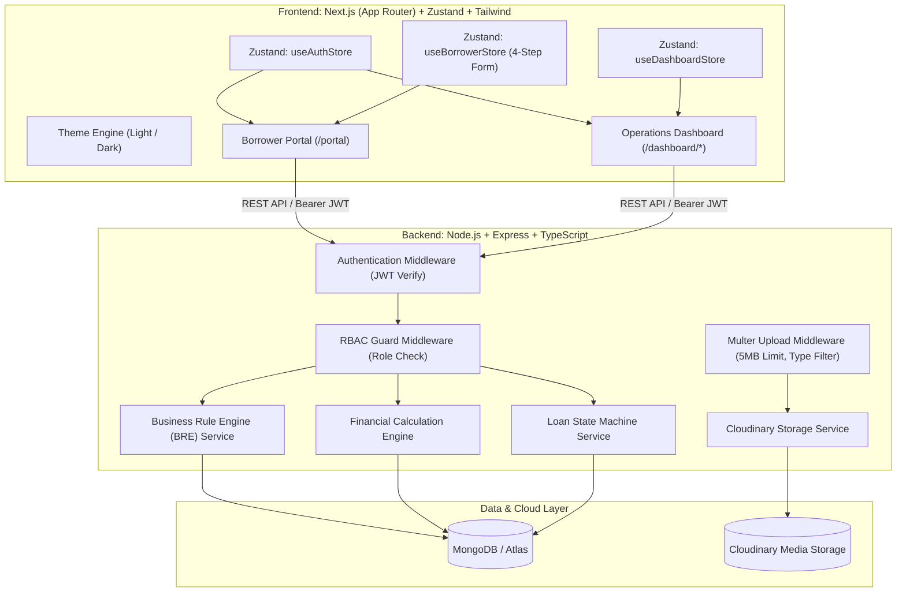
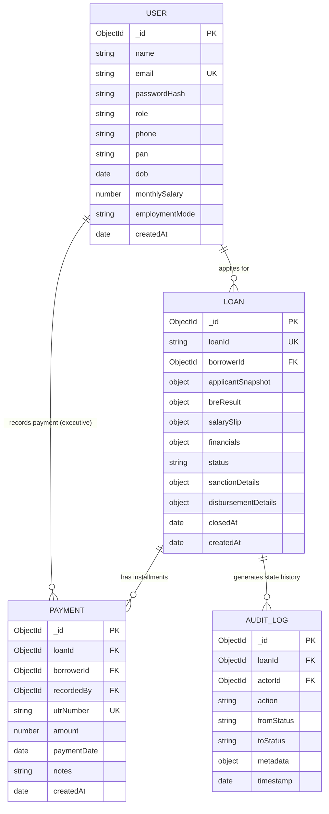
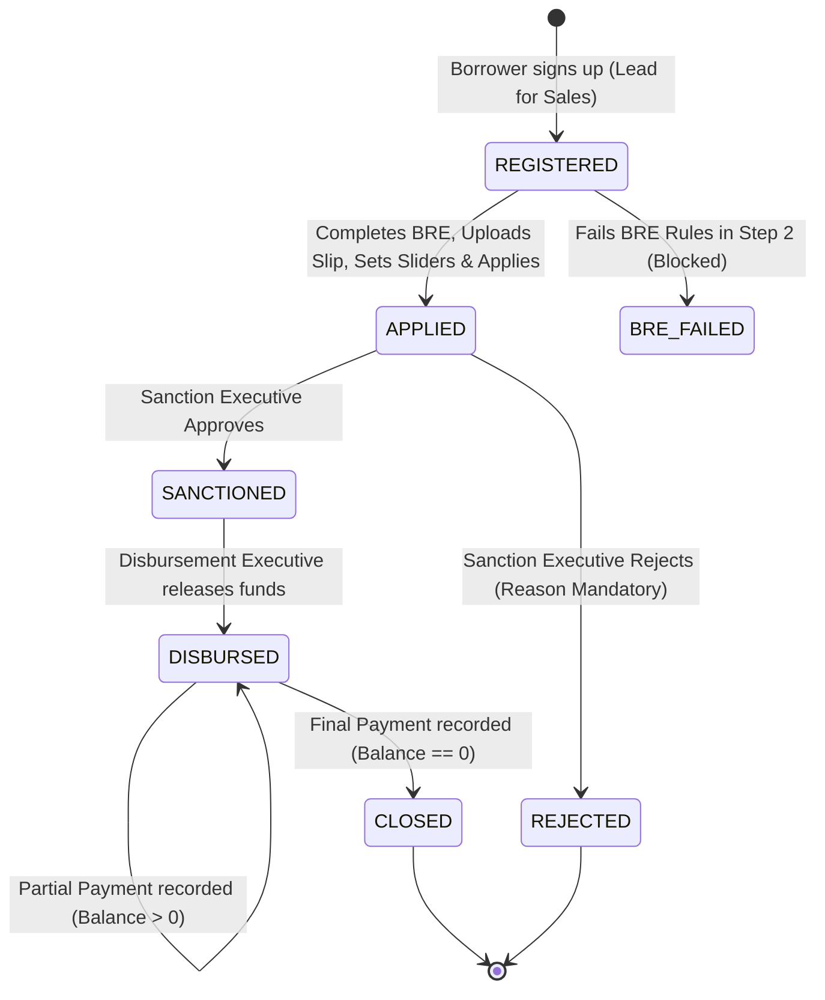

# CreditSea Loan Management System (LMS)
## Master System Design & Technical Specification

---

## 1. System Overview & Technology Stack

CreditSea LMS is a full-stack, enterprise-grade lending platform designed with two primary interfaces:
1. **Borrower Portal**: A multi-step application workflow (Authentication $\rightarrow$ Personal Details + BRE Verification $\rightarrow$ Salary Slip Upload $\rightarrow$ Interactive Loan Configuration & Submission $\rightarrow$ Application & Loan Lifecycle Tracking).
2. **Operations Dashboard**: A role-restricted internal console containing four dedicated modules (**Sales**, **Sanction**, **Disbursement**, **Collection**) plus an all-inclusive **Admin** command center.

### Tech Stack & Design System
| Layer | Technology | Key Capabilities & Justification |
|---|---|---|
| **Frontend** | Next.js (App Router) + TypeScript | Server & Client Components, Layouts, Strict Type Safety |
| **Styling & UI** | Tailwind CSS + Lucide Icons | Exact CreditSea Brand Theme (Electric Blue `#0075FF`, Hover `#0066DD`, Slate `#44465B`) |
| **Theme System** | Custom Dark / Light Mode | System preference detection, instant toggle, zero hydration flash |
| **State Management** | **Zustand** | Lightweight, reactive, persistent client state for Auth, Form Wizard, Theme, and Dashboard queues |
| **Backend API** | Node.js + Express.js + TypeScript | RESTful endpoints, layered architecture (Routes $\rightarrow$ Controllers $\rightarrow$ Services $\rightarrow$ Models) |
| **Database** | MongoDB Atlas + Mongoose | Schema validation, unique indexes (UTR, PAN, Email), atomic updates |
| **Media Storage** | **Cloudinary** (via Multer memory/stream) | Secure upload and hosting for borrower salary slips (PDF/JPG/PNG, $\le 5$MB) |
| **Auth & Security** | JWT (JSON Web Tokens) + Bcrypt | Salt rounds 10, Role-Based Access Control (RBAC) middleware on frontend & backend |

### CreditSea Official Brand Guidelines (Extracted from creditsea.com)
- **Primary Brand Color**: `#0075FF` (CreditSea Electric Blue)
- **Primary Hover / Active**: `#0066DD`
- **Brand Accent / Icon Tint**: `#0075FF14` (`rgba(0, 117, 255, 0.08)`)
- **Typography**: Inter / Plus Jakarta Sans (Modern geometric sans-serif)
- **Heading Color**: `#111827` (Dark slate) in light mode, `#F9FAFB` in dark mode
- **Subtext Color**: `#44465B` / `#4B5563`
- **Surface & Cards (Light)**: Pure white `#FFFFFF` with soft borders `border-gray-200` and subtle shadows
- **Surface & Cards (Dark)**: Deep navy `#0B0F19` background, `#111827` card containers, `#1F2937` borders, and `#0075FF` subtle glow
- **Buttons**: `bg-[#0075FF] hover:bg-[#0066DD] text-white font-semibold rounded-lg shadow-sm transition-all`
- **Form Fields**: Crisp borders `border-gray-300 dark:border-gray-700 rounded-md focus:border-[#0075FF] focus:ring-1 focus:ring-[#0075FF]`
- **Header**: Sticky white navigation bar with CreditSea logo on left, quick navigation links, and primary action buttons.


---

## 2. High-Level Architecture Diagram



---

## 3. Role-Based Access Control (RBAC) Architecture

### 3.1 Defined Roles
1. `BORROWER`: Can only access the Borrower Portal and their own loan records.
2. `SALES`: Pre-application lead tracker. Observes registered users who have not yet submitted a completed loan.
3. `SANCTION`: Underwriter console. Reviews submitted (`APPLIED`) loans, verifies salary slips and BRE reports, approves (`SANCTIONED`) or rejects (`REJECTED`) with required rationale.
4. `DISBURSEMENT`: Finance operations. Reviews `SANCTIONED` loans, confirms bank execution, logs transaction reference, and transitions to `DISBURSED`.
5. `COLLECTION`: Loan servicing. Observes active (`DISBURSED`) loans, records borrower repayment transactions with unique UTR, and triggers auto-closure when balance reaches zero.
6. `ADMIN`: Superuser with unfettered access to all 4 modules, user management, audit logs, and global analytics.

### 3.2 Granular Permission Matrix

| Resource / Action | Borrower | Sales | Sanction | Disbursement | Collection | Admin |
|---|:---:|:---:|:---:|:---:|:---:|:---:|
| Submit BRE / Form Step 2 | ✅ | ❌ | ❌ | ❌ | ❌ | ✅ |
| Upload Salary Slip (Step 3) | ✅ | ❌ | ❌ | ❌ | ❌ | ✅ |
| Configure & Submit Loan (Step 4) | ✅ | ❌ | ❌ | ❌ | ❌ | ✅ |
| View My Loans & Repayments | ✅ | ❌ | ❌ | ❌ | ❌ | ✅ |
| View Sales Leads (`REGISTERED`) | ❌ | ✅ | ❌ | ❌ | ❌ | ✅ |
| View Sanction Queue (`APPLIED`) | ❌ | ❌ | ✅ | ❌ | ❌ | ✅ |
| Approve / Reject Loan | ❌ | ❌ | ✅ | ❌ | ❌ | ✅ |
| View Disbursement Queue (`SANCTIONED`) | ❌ | ❌ | ❌ | ✅ | ❌ | ✅ |
| Disburse Loan (Release Funds) | ❌ | ❌ | ❌ | ✅ | ❌ | ✅ |
| View Collection Queue (`DISBURSED`) | ❌ | ❌ | ❌ | ❌ | ✅ | ✅ |
| Record Payment (Unique UTR) | ❌ | ❌ | ❌ | ❌ | ✅ | ✅ |
| View All Modules & Switch Views | ❌ | ❌ | ❌ | ❌ | ❌ | ✅ |

### 3.3 Security Implementation Details
- **Dual-Layer Enforcement**:
  - **Backend**: Express middleware verifies the JWT signature. Route handlers declare authorized roles via `authorizeRoles('SANCTION', 'ADMIN')`. If an unauthorized role attempts access, the API terminates the request with `403 Forbidden` (`{ success: false, message: "Access forbidden: insufficient permissions" }`).
  - **Frontend**: Next.js route middleware and client layout guards inspect `user.role` from `useAuthStore`. Borrowers attempting to access `/dashboard/*` are redirected to `/portal`. Executives attempting to access unauthorized tabs are redirected to their assigned module.

---

## 4. Database Schema & Data Models (MongoDB + Mongoose)



### 4.1 `User` Model
```typescript
{
  name: { type: String, required: true, trim: true },
  email: { type: String, required: true, unique: true, lowercase: true, trim: true, index: true },
  passwordHash: { type: String, required: true },
  role: { 
    type: String, 
    required: true, 
    enum: ['BORROWER', 'SALES', 'SANCTION', 'DISBURSEMENT', 'COLLECTION', 'ADMIN'],
    default: 'BORROWER',
    index: true 
  },
  phone: { type: String, trim: true },
  pan: { type: String, uppercase: true, trim: true },
  dob: { type: Date },
  monthlySalary: { type: Number },
  employmentMode: { 
    type: String, 
    enum: ['SALARIED', 'SELF_EMPLOYED', 'UNEMPLOYED'] 
  },
  createdAt: { type: Date, default: Date.now },
  updatedAt: { type: Date, default: Date.now }
}
```

### 4.2 `Loan` Model
```typescript
{
  loanId: { type: String, required: true, unique: true, index: true }, // Format: CS-YYYYMMDD-XXXX
  borrowerId: { type: Schema.Types.ObjectId, ref: 'User', required: true, index: true },
  
  // Immutably snapshots borrower state at submission time
  applicantSnapshot: {
    fullName: { type: String, required: true },
    pan: { type: String, required: true },
    dob: { type: Date, required: true },
    ageAtApplication: { type: Number, required: true },
    monthlySalary: { type: Number, required: true },
    employmentMode: { type: String, required: true }
  },

  // Authoritative BRE check result
  breResult: {
    status: { type: String, enum: ['PASSED', 'REJECTED'], required: true },
    failureReasons: [{ type: String }],
    evaluatedAt: { type: Date, default: Date.now }
  },

  // Uploaded Salary Slip document stored in Cloudinary
  salarySlip: {
    publicId: { type: String, required: true },
    secureUrl: { type: String, required: true },
    fileName: { type: String, required: true },
    fileSize: { type: Number, required: true },
    mimeType: { type: String, required: true },
    uploadedAt: { type: Date, default: Date.now }
  },

  // Financial structure
  financials: {
    principalAmount: { type: Number, required: true, min: 50000, max: 500000 },
    tenureDays: { type: Number, required: true, min: 30, max: 365 },
    annualInterestRate: { type: Number, required: true, default: 12.0 },
    interestAmount: { type: Number, required: true },          // (P * 12 * T) / (365 * 100)
    totalRepaymentAmount: { type: Number, required: true },    // P + SI
    totalAmountPaid: { type: Number, default: 0, min: 0 },
    outstandingBalance: { type: Number, required: true }       // totalRepayment - totalPaid
  },

  // State Machine Status
  status: {
    type: String,
    enum: ['APPLIED', 'SANCTIONED', 'REJECTED', 'DISBURSED', 'CLOSED'],
    default: 'APPLIED',
    index: true
  },

  // Module Details
  sanctionDetails: {
    reviewedBy: { type: Schema.Types.ObjectId, ref: 'User' },
    reviewedAt: { type: Date },
    decision: { type: String, enum: ['APPROVED', 'REJECTED'] },
    rejectionReason: { type: String },
    remarks: { type: String }
  },

  disbursementDetails: {
    disbursedBy: { type: Schema.Types.ObjectId, ref: 'User' },
    disbursedAt: { type: Date },
    referenceNumber: { type: String },
    paymentMode: { type: String, default: 'NEFT/RTGS' },
    disbursedAmount: { type: Number }
  },

  closedAt: { type: Date },
  createdAt: { type: Date, default: Date.now, index: true },
  updatedAt: { type: Date, default: Date.now }
}
```

### 4.3 `Payment` Model (Immutable Transaction Ledger)
```typescript
{
  loanId: { type: Schema.Types.ObjectId, ref: 'Loan', required: true, index: true },
  borrowerId: { type: Schema.Types.ObjectId, ref: 'User', required: true, index: true },
  recordedBy: { type: Schema.Types.ObjectId, ref: 'User', required: true },
  utrNumber: { type: String, required: true, unique: true, uppercase: true, trim: true, index: true },
  amount: { type: Number, required: true, min: 1 },
  paymentDate: { type: Date, required: true, default: Date.now },
  notes: { type: String },
  createdAt: { type: Date, default: Date.now }
}
```

---

## 5. Finite State Machine (FSM) & Lifecycle Transition Rules



### Transition Matrix & Guards
1. **`REGISTERED` $\rightarrow$ `APPLIED`**
   - Actor: `Borrower`
   - Pre-condition: All 4 BRE rules passed, Salary Slip verified in Cloudinary, Principal between ₹50k-₹500k, Tenure between 30-365 days.
2. **`APPLIED` $\rightarrow$ `SANCTIONED`**
   - Actor: `Sanction` or `Admin`
   - Pre-condition: Underwriter validates salary slip against stated income.
3. **`APPLIED` $\rightarrow$ `REJECTED`**
   - Actor: `Sanction` or `Admin`
   - Pre-condition: `rejectionReason` must be a non-empty string.
4. **`SANCTIONED` $\rightarrow$ `DISBURSED`**
   - Actor: `Disbursement` or `Admin`
   - Pre-condition: Bank reference number provided.
5. **`DISBURSED` $\rightarrow$ `CLOSED`**
   - Actor: `Collection` or `Admin` via Payment Recording
   - Guard: Payment amount $\le$ `outstandingBalance`. UTR must be globally unique. If new `outstandingBalance == 0`, loan status transitions automatically to `CLOSED`.

---

## 6. Business Rule Engine (BRE) Deep Dive

### 6.1 The 4 Core Rules
| Rule | Criterion | Rejection Reason Generated |
|---|---|---|
| **Age Rule** | Calculated using precise date arithmetic: $23 \le \text{Age} \le 50$ | *"Applicant age must be between 23 and 50 years. Current age: {age}."* |
| **Salary Rule** | Monthly Salary $\ge ₹25,000$ | *"Monthly salary must be at least ₹25,000. Provided: ₹{salary}."* |
| **PAN Rule** | Indian PAN regex: `^[A-Z]{5}[0-9]{4}[A-Z]{1}$` | *"Invalid PAN format. Must follow standard pattern (e.g. ABCDE1234F)."* |
| **Employment Rule** | Cannot be `Unemployed` | *"Applicant must be currently employed (Salaried or Self-Employed)."* |

### 6.2 Architectural Rationale: Client vs Server BRE
- **Why run BRE on the Client?**
  - Instant UX feedback: As users enter their DOB, salary, or PAN, field validations trigger in real time.
  - Reduced unnecessary network roundtrips: Prevents form progression if basic criteria fail.
- **Why run BRE on the Server?**
  - **Security & Integrity**: Client-side JavaScript can be bypassed via direct API calls (cURL/Postman). The backend engine provides authoritative, tamper-proof compliance before any loan is committed.

---

## 7. Financial Mathematics & Calculations

### 7.1 Formula Definition
$$SI = \frac{P \times R \times T}{365 \times 100}$$
- $P$: Principal loan amount (₹50,000 to ₹5,00,000)
- $R$: Fixed Annual Interest Rate ($12.0\%$)
- $T$: Tenure in days ($30$ to $365$ days)
$$\text{Total Repayment Amount} = P + SI$$

### 7.2 Financial Integrity & Ledger Safety
- Precision: All figures computed to 2 decimal places using `Math.round(val * 100) / 100`.
- **Payment Validation Rules**:
  1. Amount must be positive ($> 0$).
  2. Amount cannot exceed current `outstandingBalance`.
  3. UTR must be alphanumeric, non-empty, and unique across the entire database.
  4. Once `outstandingBalance == 0`, status becomes `CLOSED` and `closedAt` is stamped.

---

## 8. Cloudinary File Upload Design

### Workflow
1. User selects salary slip (PDF, JPG, PNG; max 5MB).
2. Frontend sends `multipart/form-data` to `/api/upload/salary-slip`.
3. Multer buffers the file in memory (no orphaned local temp files).
4. Server uploads the buffer to **Cloudinary** folder `creditsea/salary_slips`.
5. Cloudinary returns `secure_url`, `public_id`, and metadata.
6. Server responds with upload payload; frontend links this into the borrower's Zustand state for application submission.

---

## 9. Frontend Architecture (Next.js App Router + Zustand + Tailwind)

### 9.1 Directory Structure
```
client/
├── src/
│   ├── app/
│   │   ├── (auth)/
│   │   │   ├── login/page.tsx
│   │   │   └── register/page.tsx
│   │   ├── portal/
│   │   │   ├── page.tsx                 # Borrower Multi-step Application Form
│   │   │   └── my-loans/page.tsx        # Borrower Loan Status & Payment History
│   │   ├── dashboard/
│   │   │   ├── layout.tsx               # Shared Header, Dark/Light Toggle, Nav Tabs
│   │   │   ├── sales/page.tsx           # Lead Management Module
│   │   │   ├── sanction/page.tsx        # Sanction Review Module
│   │   │   ├── disbursement/page.tsx    # Fund Disbursement Module
│   │   │   ├── collection/page.tsx      # Payment Recording Module
│   │   │   └── admin/page.tsx           # All Modules Overview
│   │   ├── layout.tsx
│   │   ├── page.tsx                     # Landing Page & Quick Role-Switcher
│   │   └── globals.css
│   ├── components/
│   │   ├── ui/                          # Button, Modal, Card, Input, Slider, Badge, Toast
│   │   ├── portal/                      # Step1Auth, Step2PersonalBRE, Step3Upload, Step4Config
│   │   ├── dashboard/                   # ModuleDataTables, SanctionModal, PaymentModal
│   │   └── ThemeToggle.tsx              # Light / Dark Mode Toggle
│   ├── stores/
│   │   ├── useAuthStore.ts              # User, Token, Role, Logout, Login
│   │   ├── useBorrowerStore.ts          # Step Wizard State, Sliders, BRE Cache
│   │   ├── useThemeStore.ts             # Theme (light/dark), persistence in localStorage
│   │   └── useDashboardStore.ts         # Active Queues, Filtering, Modal selections
│   ├── lib/
│   │   ├── api.ts                       # Axios/Fetch client with Bearer Token interceptor
│   │   ├── bre.ts                       # Client-side BRE validator
│   │   ├── math.ts                      # Simple interest calculation engine
│   │   └── formatters.ts                # Currency (₹), Date, Phone formatters
│   └── types/
│       └── index.ts                     # TypeScript shared interfaces
├── tailwind.config.ts
└── package.json
```

### 9.2 Zustand State Stores
- **`useAuthStore`**: Stores `token`, `user: { id, name, email, role }`, `isAuthenticated`, and provides `login()`, `logout()`. Rehydrates from `localStorage`.
- **`useThemeStore`**: Stores `theme: 'light' | 'dark'`, synchronizes with document `class="dark"`, and persists in `localStorage`.
- **`useBorrowerStore`**:
  - `currentStep`: `1 | 2 | 3 | 4`
  - `personalDetails`: `{ fullName, pan, dob, monthlySalary, employmentMode }`
  - `breFeedback`: `{ status, failureReasons }`
  - `salarySlip`: `{ url, publicId, fileName, size }`
  - `loanConfig`: `{ principal: 100000, tenureDays: 90 }`
  - Computed values: `interest`, `totalRepayment`
- **`useDashboardStore`**:
  - `activeTab`: `'sales' | 'sanction' | 'disbursement' | 'collection' | 'admin'`
  - Search queries, status filters, and active action modals.

---

## 10. Complete REST API Specifications

| Method | Endpoint | Authorized Roles | Description | Request Payload | Response (200/201) |
|---|---|---|---|---|---|
| `POST` | `/api/auth/register` | Public | Create new borrower or executive | `{ name, email, password, role?, phone }` | `{ success: true, token, user }` |
| `POST` | `/api/auth/login` | Public | Sign in with email and password | `{ email, password }` | `{ success: true, token, user }` |
| `GET` | `/api/auth/me` | Authenticated | Fetch current profile | None (Bearer Token) | `{ success: true, user }` |
| `POST` | `/api/bre/evaluate` | Public / Borrower | Pre-check personal details against BRE | `{ dob, monthlySalary, pan, employmentMode }` | `{ passed: boolean, failureReasons: [] }` |
| `POST` | `/api/upload/salary-slip` | `BORROWER`, `ADMIN` | Upload salary slip to Cloudinary | `multipart/form-data` (file) | `{ success: true, file: { secureUrl, publicId, fileName } }` |
| `POST` | `/api/loans/apply` | `BORROWER`, `ADMIN` | Submit finalized loan application | `{ personalDetails, salarySlip, principalAmount, tenureDays }` | `{ success: true, loan }` |
| `GET` | `/api/loans/my-applications` | `BORROWER`, `ADMIN` | Borrower's loan history & status | None | `{ success: true, loans: [] }` |
| `GET` | `/api/operations/sales/leads` | `SALES`, `ADMIN` | Registered users who haven't completed a loan | Query: `?search=&page=` | `{ success: true, leads: [] }` |
| `GET` | `/api/operations/sanction/queue` | `SANCTION`, `ADMIN` | Queue of `APPLIED` loans | Query: `?search=&page=` | `{ success: true, loans: [] }` |
| `POST` | `/api/operations/sanction/:id/decide` | `SANCTION`, `ADMIN` | Approve or Reject loan | `{ decision: 'APPROVED' \| 'REJECTED', rejectionReason?, remarks? }` | `{ success: true, loan }` |
| `GET` | `/api/operations/disbursement/queue` | `DISBURSEMENT`, `ADMIN` | Queue of `SANCTIONED` loans | None | `{ success: true, loans: [] }` |
| `POST` | `/api/operations/disbursement/:id/disburse` | `DISBURSEMENT`, `ADMIN` | Mark loan funds as released | `{ referenceNumber, paymentMode }` | `{ success: true, loan }` |
| `GET` | `/api/operations/collection/queue` | `COLLECTION`, `ADMIN` | Queue of `DISBURSED` active loans | None | `{ success: true, loans: [] }` |
| `POST` | `/api/operations/collection/:id/payment` | `COLLECTION`, `ADMIN` | Record payment against active loan | `{ utrNumber, amount, paymentDate, notes? }` | `{ success: true, payment, loan }` |
| `GET` | `/api/operations/admin/overview` | `ADMIN` | Metrics & stats across all stages | None | `{ success: true, stats: { leads, applied, sanctioned, disbursed, closed } }` |

---

## 11. Pre-Seeded Evaluator Accounts & Test Data

The automated seed script (`npm run seed`) pre-configures:

| Role | Email | Password | Allowed Module Access |
|---|---|---|---|
| **Admin** | `admin@creditsea.com` | `Admin@123` | **All Modules** (Sales, Sanction, Disburse, Collect, Admin) |
| **Sales** | `sales@creditsea.com` | `Sales@123` | **Sales Module Only** (Lead tracking) |
| **Sanction** | `sanction@creditsea.com` | `Sanction@123` | **Sanction Module Only** (Underwriting & approvals) |
| **Disbursement** | `disburse@creditsea.com` | `Disburse@123` | **Disbursement Module Only** (Fund release) |
| **Collection** | `collect@creditsea.com` | `Collect@123` | **Collection Module Only** (UTR recording & closure) |
| **Borrower** | `borrower@creditsea.com` | `Borrower@123` | **Borrower Portal Only** (Apply & track loans) |

### Pre-Seeded Lifecycle Test Data
To ensure the evaluator sees populated dashboards immediately:
- **Sales Lead**: Registered user with no application yet.
- **Applied Loan**: Loan ready in Sanction queue with uploaded slip & passing BRE.
- **Sanctioned Loan**: Approved loan waiting in Disbursement queue.
- **Disbursed Loan**: Active loan with outstanding balance ready for payment testing in Collection queue.
- **Closed Loan**: Fully settled loan with payment ledger for demonstration.

---

## 12. Environment Configuration (`.env.example`)

### Backend (`server/.env.example`)
```env
PORT=5001
NODE_ENV=development
MONGODB_URI=mongodb+srv://<username>:<password>@cluster0.mongodb.net/creditsea?retryWrites=true&w=majority
JWT_SECRET=super_secret_creditsea_jwt_key_2026_production
JWT_EXPIRES_IN=7d
CLIENT_URL=http://localhost:3000

# Cloudinary Configuration for Salary Slip Uploads
CLOUDINARY_CLOUD_NAME=your_cloud_name
CLOUDINARY_API_KEY=your_api_key
CLOUDINARY_API_SECRET=your_api_secret
```

### Frontend (`client/.env.example`)
```env
NEXT_PUBLIC_API_URL=http://localhost:5001/api
```

---

## 13. Implementation Roadmap

1. **Step 1: Backend Setup**
   - Initialize Express + TypeScript project.
   - Configure MongoDB (Mongoose), Cloudinary SDK, and JWT/Bcrypt utilities.
   - Implement Models: `User`, `Loan`, `Payment`, `AuditLog`.
   - Implement Services: `breService`, `loanCalculationService`, `cloudinaryService`.
   - Implement Controllers & Routes with RBAC middleware.
   - Write and verify `seed.ts`.
2. **Step 2: Frontend Setup**
   - Initialize Next.js (App Router) + TypeScript + Tailwind CSS.
   - Configure Zustand stores: `useAuthStore`, `useThemeStore`, `useBorrowerStore`, `useDashboardStore`.
   - Setup Light / Dark theme system with responsive CSS design tokens.
3. **Step 3: Borrower Portal Implementation**
   - Step 1: Sign up & Login.
   - Step 2: Personal Details with live BRE validation & error diagnostics.
   - Step 3: Cloudinary salary slip uploader (drag & drop, preview, size check).
   - Step 4: Loan configuration sliders (₹50k-₹500k, 30-365 days) with live Simple Interest math summary.
   - Loan Status & Timeline viewer for borrowers.
4. **Step 4: Operations Dashboard Implementation**
   - Role-guarded layout with module switcher for Admin.
   - Sales Module (Leads table).
   - Sanction Module (Application review, document preview, approve/reject dialog).
   - Disbursement Module (Sanctioned list, release funds dialog).
   - Collection Module (Active loans, UTR payment modal, live balance updater, auto-closure).
   - Quick "One-Click Role Switcher" helper for the evaluator.
5. **Step 5: Testing, Documentation & Submission Preparation**
   - End-to-end verification of all lifecycle transitions.
   - Comprehensive `README.md` with setup guide, credentials, and video walkthrough script.
